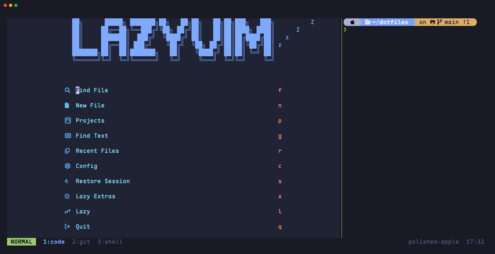
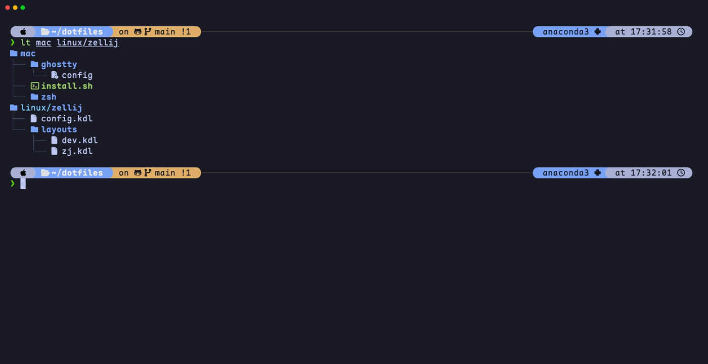
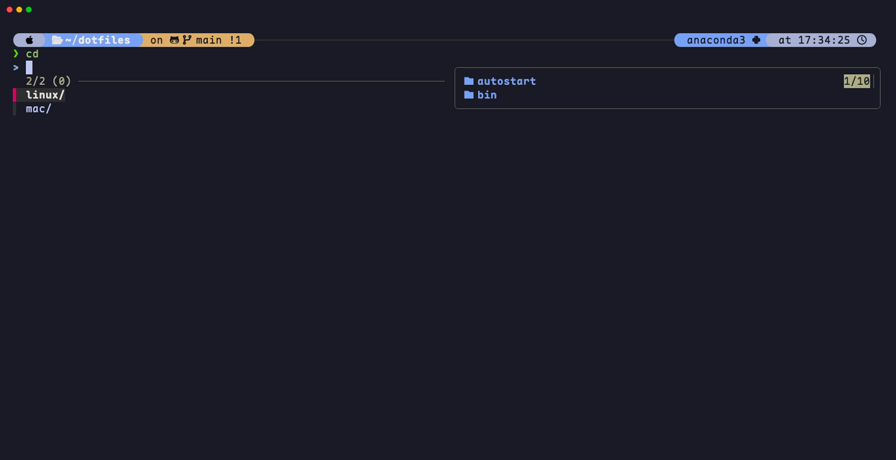
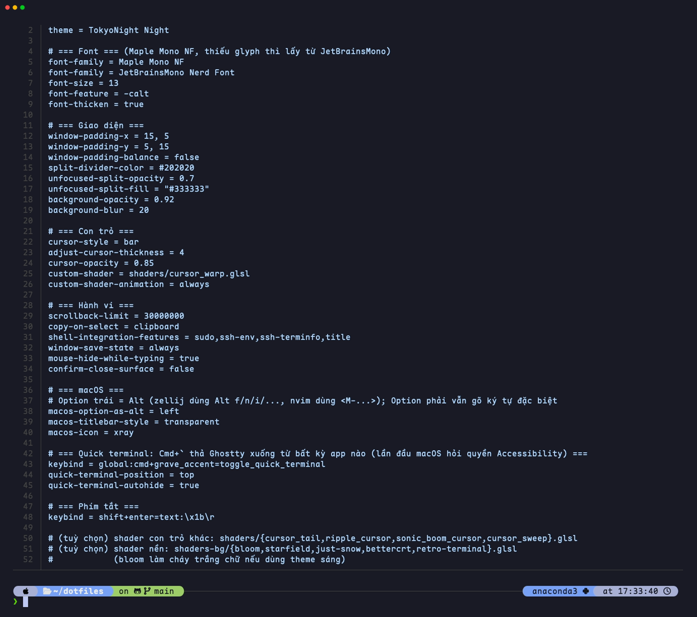
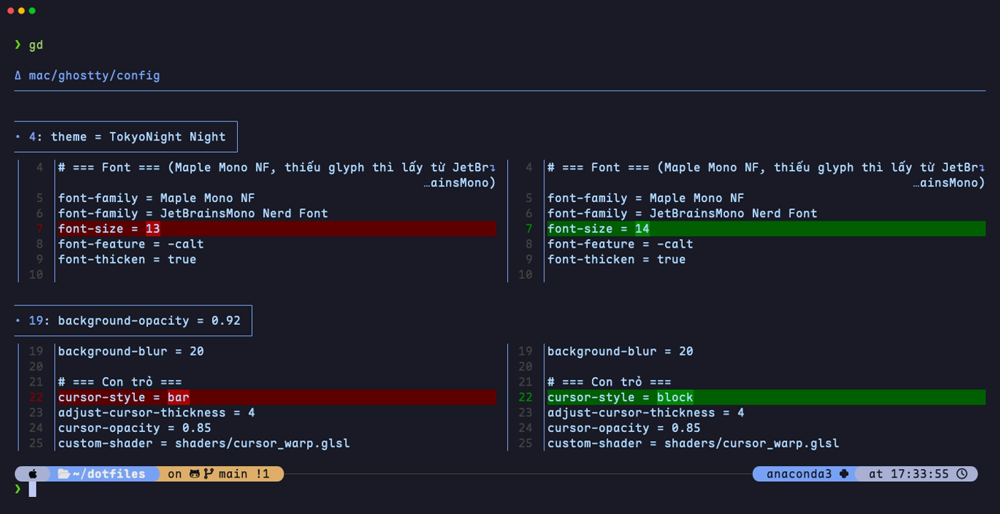
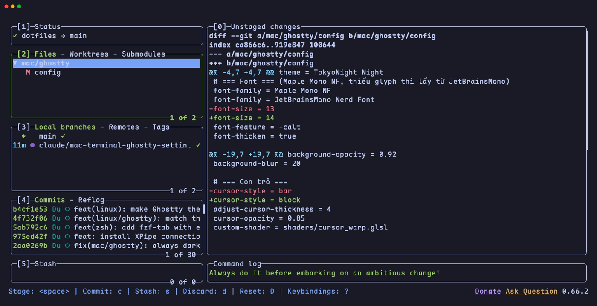
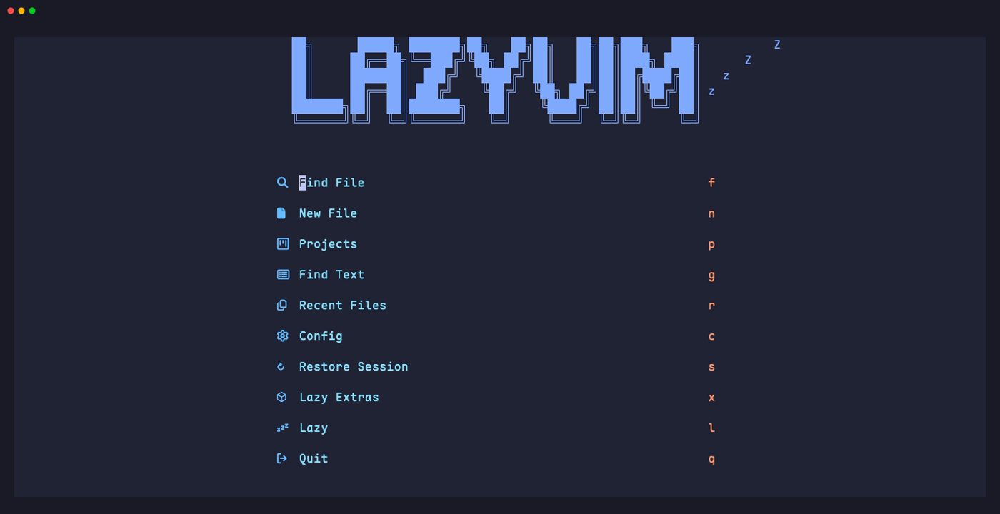

# Dotfiles: Ghostty + zsh + Neovim cho macOS và Ubuntu

Một lệnh cài là có cùng một terminal trên Mac và Ubuntu: Ghostty (TokyoNight, Maple Mono), zsh + powerlevel10k, Neovim (LazyVim), zellij và các tool dòng lệnh hiện đại.



## Cài đặt

```bash
git clone https://github.com/DucLong06/iTerm2.git ~/dotfiles && ~/dotfiles/install.sh
```

`install.sh` tự nhận ra macOS hay Linux rồi chạy `mac/install.sh` hoặc `linux/install.sh`.

- **macOS:** dùng Homebrew (tự cài nếu chưa có). Máy sẽ hỏi mật khẩu khi cài Homebrew và XPipe.
- **Ubuntu:** hỏi có dùng proxy không (Enter = không), cần `sudo`. Cài xong thì khởi động lại máy và chạy thêm một lần `~/dotfiles/install.sh --skip-apt`.

Sau đó mở **Ghostty**. Chạy lại bao nhiêu lần cũng được: file nào bị thay đều có bản backup `*.bak-<ngày>` bên cạnh.

| Muốn | Lệnh |
|---|---|
| Cập nhật | `cd ~/dotfiles && git pull && ./install.sh` |
| Chỉ cài lại config | `./install.sh --only configs` |
| Xem các bước | `./install.sh --list-steps` |

## Trông như thế nào

**Prompt + `lt`** (eza dạng cây, có icon và trạng thái git)



**fzf-tab:** gõ `cd ` rồi bấm Tab, có khung xem trước



**Config Ghostty** (`cat` = bat, có tô màu)



**`gd`** (git diff qua delta, hai cột)



**`lazygit`**



**`nvim`** (LazyVim)



## Có gì trong bộ cài

| Nhóm | Gồm |
|---|---|
| Terminal | Ghostty: TokyoNight Night, Maple Mono NF, nền trong suốt, con trỏ `cursor_warp`. Mac: Option trái = Alt, ``Cmd+` `` thả terminal xuống |
| Shell | zsh + oh-my-zsh + powerlevel10k, autosuggestions, syntax-highlighting, fzf-tab, you-should-use |
| Editor | Neovim + LazyVim (plugin ghim theo `lazy-lock.json`) |
| Chia màn hình | zellij (thanh `zjstatus`, `Ctrl+hjkl` chuyển giữa nvim và pane), tmux |
| Tool | eza, bat, zoxide, atuin, yazi, fzf, ripgrep, fd, lazygit, delta, lazydocker, glow, tldr, fastfetch |
| Runtime | nvm + Node LTS, uv, Go |
| SSH | gssh (ssh mang theo gợi ý + tô màu sang máy remote), XPipe |
| Riêng Ubuntu | Ghostty là terminal mặc định (Ctrl+Alt+T, chuột phải trong Nautilus), tự chuyển bộ gõ trong Ghostty, proxy tuỳ chọn, cấu hình VS Code |

## Lệnh hay dùng

| Lệnh / phím | Làm gì |
|---|---|
| `ll`, `la`, `lt` | Liệt kê file (eza) |
| `z <tên>` | Nhảy tới thư mục hay dùng |
| `Ctrl+R` | Tìm lịch sử lệnh (atuin) |
| `y` | Duyệt file bằng yazi, thoát thì `cd` theo |
| `gd`, `lazygit` | Xem diff, quản lý git |
| `zellij -l dev` | nvim + shell + git trong một cửa sổ |
| `Cmd+Shift+,` | Nạp lại config Ghostty (Ubuntu: `Ctrl+Shift+,`) |

## Tuỳ chỉnh

- Cài đặt riêng của từng máy (alias, đường dẫn SDK…) để trong `~/.zsh_local`. File này không nằm trong repo.
- Đổi theme: chạy `ghostty +list-themes` trong Ghostty để xem thử, rồi sửa dòng `theme` trong `mac/ghostty/config` hoặc `linux/ghostty/config`.
- Đổi kiểu prompt: `p10k configure`.
- XPipe: Settings → Terminal → Ghostty; Settings → Sync → trỏ tới một repo git **private** để đồng bộ host giữa các máy.

## Cấu trúc repo

```
install.sh          chọn mac/ hoặc linux/
mac/                install.sh, zsh/.zshrc, ghostty/config
linux/              install.sh, zsh/, ghostty/, nvim/, zellij/, tmux/, vscode/ (nvim, zellij, tmux, p10k dùng chung cho Mac)
docs/images/        ảnh trong README; tạo lại bằng: for t in docs/tapes/[!_]*.tape; do vhs "$t"; done
docs/legacy-iterm2.md   hướng dẫn iTerm2 cũ
```
